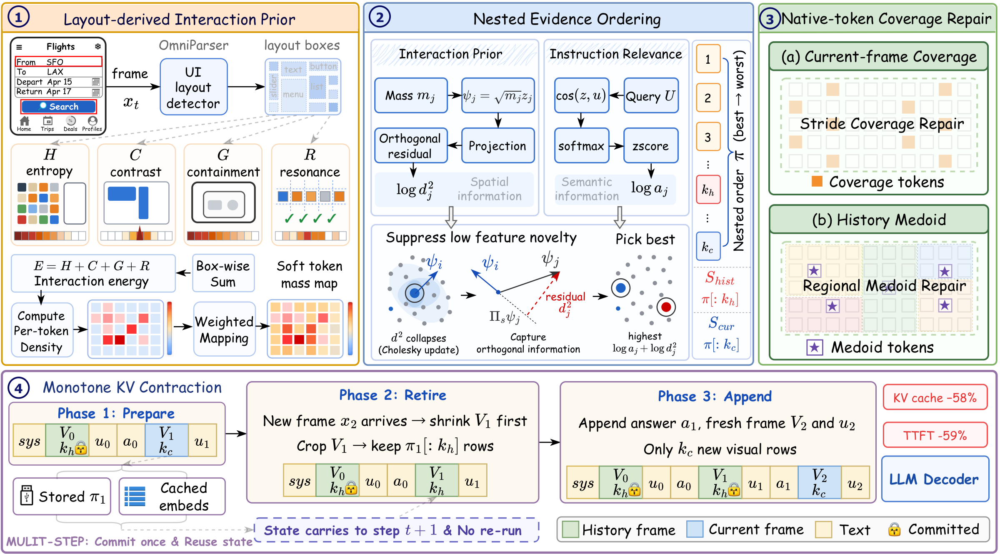

<div align="center">

# TRACE

**T**rajectory-robust **A**dmission and **C**overage-aware **E**vidence ordering<br>for Efficient GUI Agents

Training-free visual token admission under a reusable visual-state lifecycle.

[](https://arxiv.org/abs/2609.10297)
[](https://arxiv.org/pdf/2609.10297)
[](https://arxiv.org/html/2609.10297v1)
[](LICENSE)



<em>Figure 1. TRACE commits a nested keep once (LIP + NEO + NCR) and contracts it monotonically with MKC.</em>

</div>

## News

- **2026-09-09** — Paper released on [arXiv](https://arxiv.org/abs/2609.10297) ([HTML](https://arxiv.org/html/2609.10297v1), [PDF](https://arxiv.org/pdf/2609.10297)).

## Highlights

- **Training-free admission.** Layout-derived Interaction Prior (LIP), Nested Evidence Ordering (NEO), and Native-token Coverage Repair (NCR) write a nested keep *before* the first LLM prefill. Historical budgets are prefixes of the current keep — no re-selection, no re-encoding.
- **Monotone KV contraction (MKC).** Retired frames shrink in place to the history prefix and are replayed as native cache rows.
- **Tight-budget accuracy.** On GUI-Owl-1.5-8B, TRACE retains **78.7%** (mild) and **61.1%** (tight) of dense performance across six GUI benchmarks — vs. 72.4% / 49.2% for the strongest existing selector.
- **Serving.** TTFT **1116.8 → 452.7 ms** (**2.4×**) and visual KV cache **697 → 292 MB** on OmniGUI.
- **Transfer.** Same protocol on GUI-Owl-1.5-2B and UI-TARS-1.5-7B.

## Method

TRACE treats visual token pruning as an *irreversible write-time admission* once cache reuse is enabled:

| Module | Role |
| --- | --- |
| **LIP** | Maps OmniParser detections into a query-independent interaction prior over operable regions. |
| **NEO** | Fuses that prior with instruction relevance and feature novelty into one nested keep order. |
| **NCR** | Restores spatial coverage with native stride tokens (current) and medoid tokens (history). |
| **MKC** | Crops a retiring frame to its history prefix and restores retained rows in the next prefill. |

Full definitions, algorithms, and protocol are in the [paper](https://arxiv.org/pdf/2609.10297).

## Results

Evaluation uses matched visual-token budgets on ScreenSpot-v2, ScreenSpot-Pro, MMBench-GUI L2, OmniGUI, Mind2Web, and AndroidControl. **Avg. (%)** is performance relative to the dense (100% token) upper bound.

**GUI-Owl-1.5-8B**

| Setting | Budget | TRACE Avg. | Best existing Avg. | SS-v2 (TRACE / best existing) |
| --- | --- | ---: | ---: | ---: |
| Mild | $r{=}10\%$, $(c,h){=}(50\%,10\%)$ | **78.7%** | 72.4% | **73.90** / 58.96 |
| Tight | $r{=}5\%$, $(c,h){=}(25\%,5\%)$ | **61.1%** | 49.2% | **55.19** / 34.20 |

On GUI-Owl-1.5-2B at the tight budget, TRACE retains **52.9%** of dense performance (best existing: 43.5%). Per-benchmark scores, ablations, UI-TARS transfer, and serving breakdowns are in the paper.

## Code

**Coming soon.** The source code will be released in this repository.

## Citation

```bibtex
@article{wang2026trace,
  title   = {TRACE: Trajectory-robust Admission with Evidence Ordering for Efficient GUI Agents},
  author  = {Wang, Yuhao and Qiao, Mu and Zhang, Xindong and Zhang, Lei and Zhuge, Yunzhi and Lu, Huchuan},
  journal = {arXiv preprint arXiv:2609.10297},
  year    = {2026}
}
```

## Acknowledgements

This work is a collaboration of Dalian University of Technology, OPPO Research Institute, and The Hong Kong Polytechnic University.

## License

This project is released under [CC BY 4.0](LICENSE).
