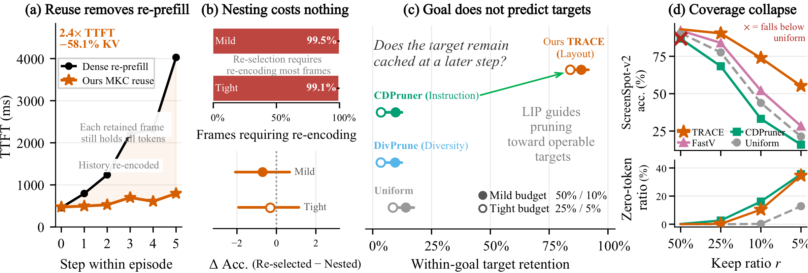
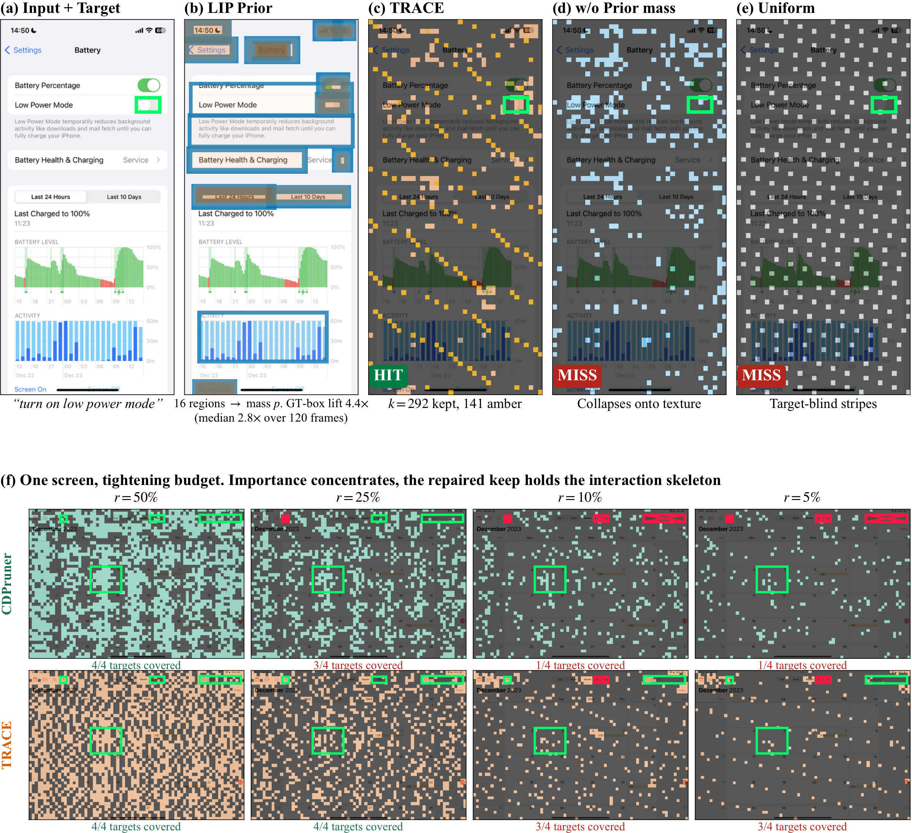
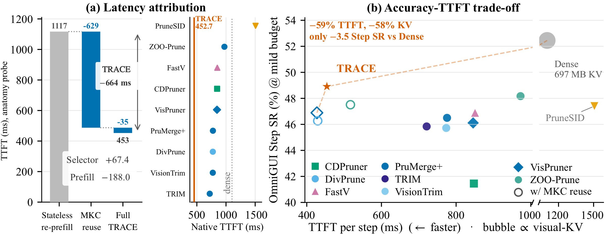

<div align="center">

# TRACE: Trajectory-robust Admission with Evidence Ordering for Efficient GUI Agents

**T**rajectory-robust **A**dmission and **C**overage-aware **E**vidence ordering

[Yuhao Wang](https://924973292.github.io/)<sup>1</sup> ·
Mu Qiao<sup>1</sup> ·
Xindong Zhang<sup>2</sup> ·
Lei Zhang<sup>2,3</sup> ·
Yunzhi Zhuge<sup>1</sup> ·
[Huchuan Lu](https://scholar.google.com/citations?user=D3nE0agAAAAJ&hl=zh-CN)<sup>1</sup>

<sup>1</sup>Dalian University of Technology &ensp;
<sup>2</sup>OPPO Research Institute &ensp;
<sup>3</sup>The Hong Kong Polytechnic University

[](https://arxiv.org/abs/2609.10297)
[](https://arxiv.org/pdf/2609.10297)
[](https://arxiv.org/html/2609.10297v1)
[](LICENSE)

A training-free visual token admission framework for efficient GUI agents under a reusable visual-state lifecycle.

</div>

## Abstract

GUI agents accumulate high-resolution screenshots as the trajectory unfolds, increasing inference latency and memory usage. Training-free visual token pruning can reduce this cost, but cache reuse introduces a fundamental constraint. Once tokens are discarded, the corresponding visual evidence cannot be recovered without re-encoding. Pruning therefore becomes an *irreversible admission decision* that must remain useful for unknown future targets while preserving coverage of operable regions under tight budgets.

To address these challenges, we propose **TRACE**, a training-free framework for Trajectory-robust Admission and Coverage-aware Evidence ordering. Specifically, we combine a query-independent layout-derived interaction prior with instruction relevance and feature novelty to rank visual evidence according to both potential future utility and diversity. Then, we reserve part of the budget for native visual tokens distributed across the screen, repairing missing spatial coverage without breaking the ordering. Together, these mechanisms produce a nested token order, allowing retained visual evidence to shrink monotonically across budgets while remaining reusable throughout the trajectory. Finally, our monotone KV contraction incrementally contracts retired frames into compact session state, avoiding repeated visual encoding or pruning.

Extensive experiments across six GUI benchmarks and diverse models verify the effectiveness of TRACE under tight budgets. The source code is available in this repository.

## News

- **2026.09**: Paper released on [arXiv](https://arxiv.org/abs/2609.10297) ([HTML](https://arxiv.org/html/2609.10297v1), [PDF](https://arxiv.org/pdf/2609.10297)).
- **2026.11**: Source code released in this repository.

## Table of Contents

- [Introduction](#introduction)
- [Contributions](#contributions)
- [Method](#method)
- [Experimental Setup](#experimental-setup)
- [Results](#results)
- [Code](#code)
- [Citation](#citation)
- [Contact](#contact)
- [Acknowledgements](#acknowledgements)
- [License](#license)

## Introduction

Multimodal large language models are increasingly deployed as agents that complete multi-step tasks by perceiving and acting on graphical user interfaces. At each step, a GUI agent processes the high-resolution screenshot together with context accumulated from earlier interactions. As the trajectory unfolds, visual computation grows to dominate the inference cost: each historical screenshot carries a large number of visual tokens and recurs across successive steps.

Cache reuse mitigates the *temporal* redundancy across frames by limiting past computation. That mechanism, however, operates at frame granularity and leaves substantial *spatial* redundancy within each retained screenshot. The core problem therefore becomes deciding which visual tokens enter the reusable state of each frame.

Training-free visual token pruning is effective when the selection can be recomputed whenever the query changes. Multi-step GUI serving breaks this premise once visual state becomes reusable: each screenshot is encoded and written into the session cache only at its first prefill. Later steps read history from that cache rather than pixels, so tokens dropped at the single write are absent for every future query and can only be recovered by re-encoding the frame.

**Visual token pruning thus shifts from revisable selection to irreversible write-time commitment of visual evidence.** Under this commitment, each frame should be admitted once before prefill, reused while current, and contracted when it becomes history. Contraction can only drop tokens from the committed state, so the historical keep sets should nest inside the current one. Pruning therefore must output a nested order whose prefixes realize every budget.

This formulation exposes two distinct challenges:

1. **Trajectory uncertainty.** The task goal is known at admission, yet the fine-grained targets along the trajectory remain unknown. Instruction-based pruning can miss a later target on a recurring screen, whereas a layout-derived prior still covers operable regions before those demands appear.
2. **Spatial coverage under tight budgets.** Biased pruning concentrates on a few salient regions, leaving other operable regions with zero support. As the budget tightens, such biased keeps leave a growing uncovered area and can fall below uniform sampling.

<p align="center">
  
</p>
<p align="center"><em>Figure 1. Motivation of TRACE. (a) Reusing the cache removes repeated prefill and lowers latency. (b) Independent re-selection demands re-encoding on most frames, while the nested order costs no accuracy. (c) Instruction-based pruning misses the target in later steps while layout-based pruning retains it. (d) Concentrating the budget on salient regions loses spatial coverage.</em></p>

## Contributions

- We formulate *lifecycle-aware visual pruning* as *write-time visual evidence commitment under trajectory uncertainty*. Once visual state is reusable, pruning becomes an irreversible admission with nested keep sets across budgets, exposing two challenges: committing evidence before later targets appear, and preserving spatial coverage under tight budgets.
- We propose **TRACE**, a training-free framework that commits visual evidence once and contracts it monotonically thereafter. **LIP** injects a query-independent layout prior, **NEO** builds one nested evidence order, **NCR** restores native-token spatial coverage, and **MKC** turns the admitted order into reusable session state without re-encoding historical frames.
- Extensive experiments across six GUI benchmarks verify the effectiveness of TRACE under single-step and multi-step settings, multiple model scales, and a cross-family backbone.

## Method

TRACE treats visual token pruning as an irreversible write-time admission once cache reuse is enabled. For each frame, let \(S^{\mathrm{cur}}\) be the positions retained while the frame is current and \(S^{\mathrm{hist}}\) the smaller subset retained after retirement. A reusable visual-state lifecycle imposes three constraints:

1. Admission uses only information available before the first LLM prefill.
2. History is a subset of the current keep (\(S^{\mathrm{hist}} \subseteq S^{\mathrm{cur}}\)).
3. Kept tokens remain native encoder outputs, so they can later be dropped as cache rows.

<p align="center">
  
</p>
<p align="center"><em>Figure 2. Overview of TRACE. (a) LIP maps UI detections into an interaction prior. (b) NEO fuses this prior with instruction relevance and feature novelty into one nested order. (c) NCR refills spatial gaps with native coverage and medoid tokens. (d) MKC crops each retiring frame to its history prefix and restores retained rows in the next prefill.</em></p>

| Module | Role |
| --- | --- |
| **LIP** | Layout-derived Interaction Prior. Maps OmniParser detections into a query-independent interaction prior over operable regions. |
| **NEO** | Nested Evidence Ordering. Fuses that prior with instruction relevance and feature novelty into one nested keep order. |
| **NCR** | Native-token Coverage Repair. Restores spatial coverage with native stride tokens (current) and medoid tokens (history). |
| **MKC** | Monotone KV Contraction. Crops a retiring frame to its history prefix and restores retained rows in the next prefill. |

### Layout-derived Interaction Prior (LIP)

Instruction relevance cannot anticipate later step demands, while uniform geometry does not separate operable regions from background. LIP maps layout detections such as buttons and text fields into an interaction prior for subsequent token pruning.

For each detected box we compute entropy \(H\), contrast \(C\), containment \(G\), and resonance \(R\), and form the interaction energy \(E = H + C + G + R\). Dividing by the number of active UI tokens covered by the box yields a per-token density, which is scattered onto the visual-token grid and max-normalized into a field \(P\). The density is converted into a soft token mass \(m_j = 1 + \alpha N p_j\), which biases the subsequent ordering toward layout regions while keeping every token eligible.

### Nested Evidence Ordering (NEO)

Pure relevance concentrates the budget on the strongest instruction matches, whereas diversity alone overlooks structurally important regions. NEO fuses the interaction prior with instruction relevance and feature novelty into a nested order, so every later budget is a prefix rather than a re-selection.

Each visual token is scored by a softmax of z-scored max cosine similarity to the instruction query rows. Features are reweighted by the interaction prior, and greedy relevance-weighted orthogonal residual selection chooses the next token by \(\log a_j + \log d_j^2(S)\), where \(d_j^2(S)\) is the residual novelty against the already selected set. Repeating this update produces a nested order \(\pi\) whose prefixes realize every budget. Retirement can therefore delete a suffix of \(\pi\) rather than reselect the frame.

### Native-token Coverage Repair (NCR)

Biased pruning concentrates on a few strong regions and leaves other areas empty. NCR restores spatial coverage with native tokens while preserving the nested order.

On the current frame, a coverage dose is drawn from the raster-ordered complement by stride sampling and replaces the unprotected tail of \(\pi\). When the same frame retires to the smaller history budget, coverage is restored with feature medoids of near-equal spatial regions rather than another stride sample. The protected prefix and these native repair tokens jointly define the history subset, which stays nested inside the current keep.

### Monotone KV Contraction (MKC)

Admission yields its advantage only if serving contracts a retired frame into the next prefill without a second visual encoding. MKC realizes the reusable visual-state lifecycle in three phases:

1. **Prepare.** The session holds past frames at the history budget, the current frame at the current budget, and the nested order with native visual embeddings.
2. **Retire.** When a new screenshot arrives, MKC truncates the cache at the current-frame boundary and crops stored embeddings to the history prefix of \(\pi\). The operation is indexing alone.
3. **Append.** The cropped rows are restored together with the new frame and instruction in one merged LLM forward pass. Only the fresh frame is newly encoded.

Full definitions, algorithms, and protocol are in the [paper](https://arxiv.org/pdf/2609.10297).

## Experimental Setup

**Models.** We evaluate native GUI agent models that ground natural-language instructions on raw screenshots and emit executable actions. The GUI-Owl-1.5 series is the primary backbone for grounding and multi-step control. UI-TARS-1.5-7B tests generalization under a different model family and action grammar.

**Benchmarks.** Evaluation covers both single-step and multi-step settings across six public benchmarks:

| Setting | Benchmarks | Metric |
| --- | --- | --- |
| Single-step | ScreenSpot-v2 (SS-v2), ScreenSpot-Pro (SS-Pro), MMBench-GUI L2 | Official accuracy |
| Multi-step | OmniGUI, Mind2Web, AndroidControl | Step SR (action type and target/argument both correct) |

**Budgets.** All methods are compared at matched visual-token budgets. The single-step setting retains a fraction \(r\) of the visual tokens. The multi-step setting independently controls the current and historical budgets with \(c\) and \(h\).

| Setting | Single-step | Multi-step |
| --- | --- | --- |
| Mild | \(r = 10\%\) | \(c = 50\%\), \(h = 10\%\) |
| Tight | \(r = 5\%\) | \(c = 25\%\), \(h = 5\%\) |

On UI-TARS-1.5-7B the single-step keep is \(r = 25\%\) (mild) and \(r = 10\%\) (tight); the multi-step \((c, h)\) pair is unchanged. **Avg. (%)** is performance relative to the dense (100% token) upper bound.

## Results

In the tables below, the best and second-best results in each column are shown in **bold** and *italic*, respectively. Method names are reported without venue tags.

### GUI-Owl-1.5-8B

On GUI-Owl-1.5-8B, TRACE retains **78.7%** (mild) and **61.1%** (tight) of dense performance across the six benchmarks, versus 72.4% / 49.2% for the strongest existing selector. At the mild budget, TRACE leads PruneSID by 14.94 points on SS-v2 and VisPruner by 8.12 points on MMBench-GUI; VisionTrim stays ahead by 0.89 points on the 4K icon-dense SS-Pro. At \(r = 5\%\), TRACE leads on all three single-step benchmarks, and the SS-v2 margin over PruneSID grows to 20.99 points.

**Upper bound (100% tokens)**

| Method | SS-v2 | SS-Pro | MMBench-GUI | OmniGUI | Mind2Web | AndroidControl | Avg. (%) |
| --- | ---: | ---: | ---: | ---: | ---: | ---: | ---: |
| GUI-Owl-1.5-8B | 93.79 | 70.34 | 82.64 | 52.45 | 52.90 | 60.41 | 100.0 |

**Mild budget** (\(r = 10\%\) \(\Vert\) \(c = 50\%\), \(h = 10\%\))

| Method | SS-v2 | SS-Pro | MMBench-GUI | OmniGUI | Mind2Web | AndroidControl | Avg. (%) |
| --- | ---: | ---: | ---: | ---: | ---: | ---: | ---: |
| Random | 33.81 | 6.14 | 18.53 | 43.16 | 35.13 | 58.82 | 52.2 |
| Uniform | 43.79 | 10.69 | 28.27 | 46.11 | 39.65 | 59.08 | 59.5 |
| DivPrune | 51.97 | 13.98 | 31.61 | 45.76 | 40.70 | 58.83 | 62.5 |
| CDPruner | 33.18 | 11.26 | 12.21 | 41.45 | 27.88 | 54.57 | 48.0 |
| VisPruner | 51.73 | 34.41 | *42.35* | 46.11 | 44.45 | 59.25 | 70.9 |
| PruMerge+ | 40.49 | 19.80 | 30.47 | 46.50 | 41.53 | 59.28 | 62.2 |
| TRIM | 36.24 | 3.29 | 25.24 | 45.84 | 41.20 | 56.86 | 55.5 |
| FastV | 52.04 | 28.53 | 40.21 | 46.89 | 43.12 | 59.11 | 68.9 |
| VisionTrim | 58.65 | **38.52** | 40.71 | 45.72 | 43.91 | 59.10 | *72.4* |
| ZOO-Prune | 56.29 | 9.55 | 35.98 | *48.17* | *44.98* | 59.30 | 65.4 |
| PruneSID | *58.96* | 15.69 | 40.65 | 47.40 | 43.28 | *59.52* | 67.5 |
| **TRACE** | **73.90** | *37.63* | **50.47** | **48.91** | **45.52** | **60.20** | **78.7** |

**Tight budget** (\(r = 5\%\) \(\Vert\) \(c = 25\%\), \(h = 5\%\))

| Method | SS-v2 | SS-Pro | MMBench-GUI | OmniGUI | Mind2Web | AndroidControl | Avg. (%) |
| --- | ---: | ---: | ---: | ---: | ---: | ---: | ---: |
| Random | 15.49 | 1.27 | 9.29 | 34.25 | 18.43 | 52.07 | 36.0 |
| Uniform | 21.38 | 3.04 | 12.24 | 38.96 | 20.61 | *56.13* | 41.3 |
| DivPrune | 25.71 | 3.86 | 14.11 | 37.17 | 24.29 | 54.75 | 42.9 |
| CDPruner | 15.88 | 3.48 | 4.76 | 27.76 | 10.86 | 40.90 | 28.1 |
| VisPruner | 20.68 | 12.21 | 16.75 | 39.54 | *30.67* | 54.93 | 47.3 |
| PruMerge+ | 17.85 | 5.88 | 12.19 | 36.98 | 23.45 | 54.01 | 41.1 |
| TRIM | 15.88 | 0.44 | 9.85 | 34.37 | 23.01 | 47.17 | 36.1 |
| FastV | 28.38 | 11.83 | *20.51* | 39.39 | 29.33 | 54.61 | 48.8 |
| VisionTrim | 25.86 | *18.22* | 16.86 | 38.26 | 30.20 | 55.16 | *49.2* |
| ZOO-Prune | 28.46 | 3.48 | 15.33 | 40.01 | 27.90 | 55.76 | 45.9 |
| PruneSID | *34.20* | 4.55 | 19.48 | *40.09* | 27.57 | 55.46 | 47.8 |
| **TRACE** | **55.19** | **20.30** | **30.88** | **43.08** | **34.20** | **57.06** | **61.1** |

<p align="center">
  
</p>
<p align="center"><em>Figure 3. Keep maps on one SS-v2 screen carrying four instruction targets with GUI-Owl-1.5-8B. Instruction-conditioned keeps contract onto the highest-scoring region as the budget tightens, whereas the repaired keep still retains three of four targets at \(r = 5\%\).</em></p>

### GUI-Owl-1.5-2B (tight)

On GUI-Owl-1.5-2B at the tight budget, TRACE retains **52.9%** of dense performance, while the best existing method (PruneSID) retains 43.5%. TRACE ranks first on four of the six benchmarks. The prior and coverage signals are computed before prefill and do not depend on the checkpoint, so the advantages survive the scale change.

**Upper bound (100% tokens)**

| Method | SS-v2 | SS-Pro | MMBench-GUI | OmniGUI | Mind2Web | AndroidControl | Avg. (%) |
| --- | ---: | ---: | ---: | ---: | ---: | ---: | ---: |
| GUI-Owl-1.5-2B | 90.49 | 57.94 | 71.84 | 39.70 | 44.23 | 57.93 | 100.0 |

**Tight budget** (\(r = 5\%\) \(\Vert\) \(c = 25\%\), \(h = 5\%\))

| Method | SS-v2 | SS-Pro | MMBench-GUI | OmniGUI | Mind2Web | AndroidControl | Avg. (%) |
| --- | ---: | ---: | ---: | ---: | ---: | ---: | ---: |
| Random | 14.54 | 1.71 | 8.35 | 24.77 | 16.21 | 47.43 | 35.3 |
| Uniform | 13.52 | 2.59 | 8.07 | 25.66 | 15.92 | 52.38 | 36.9 |
| DivPrune | 18.00 | 2.28 | 8.57 | 26.52 | 20.52 | 50.30 | 39.3 |
| CDPruner | *22.17* | 2.66 | *13.05* | 27.10 | 18.20 | 50.19 | 40.6 |
| VisPruner | 12.81 | 2.34 | 6.68 | 22.55 | 18.85 | 48.59 | 35.1 |
| PruMerge+ | 12.03 | 2.34 | 6.98 | 23.17 | 14.68 | 47.35 | 33.4 |
| TRIM | 17.37 | 1.58 | 9.63 | 25.35 | 23.58 | 51.28 | 40.2 |
| FastV | 10.46 | *6.58* | 7.57 | 25.51 | **27.62** | 51.71 | 41.6 |
| VisionTrim | 17.30 | 4.43 | 9.43 | 23.72 | 17.80 | 49.43 | 37.5 |
| ZOO-Prune | 19.50 | 1.58 | 10.35 | 26.17 | 22.78 | 53.06 | 41.3 |
| PruneSID | 19.97 | 1.83 | 10.66 | *27.53* | 25.68 | **54.13** | *43.5* |
| **TRACE** | **38.29** | **6.83** | **21.93** | **31.88** | *26.52* | *53.72* | **52.9** |

### UI-TARS-1.5-7B

The same protocol transfers to UI-TARS-1.5-7B. TRACE is best at both budgets, and the margins over DivPrune grow from 0.39–2.80 points at the mild budget to 0.79–4.92 points at the tight budget. The gap is widest on tight Mind2Web (17.92 vs. 13.00).

| Method | SS-v2 | SS-Pro | OmniGUI | Mind2Web |
| --- | ---: | ---: | ---: | ---: |
| UI-TARS-1.5-7B (dense) | 89.86 | 42.19 | 49.77 | 42.94 |
| | | | | |
| *Mild* (\(r = 25\%\), \(c = 50\%\), \(h = 10\%\)) | | | | |
| Random | 50.08 | 7.15 | 38.00 | 27.69 |
| Uniform | 48.74 | 4.49 | 40.24 | 25.98 |
| DivPrune | *69.89* | *14.86* | *42.47* | *32.33* |
| CDPruner | 59.43 | 12.90 | 35.83 | 27.16 |
| PruneSID | 68.87 | 13.41 | 41.55 | 31.21 |
| **TRACE** | **70.28** | **16.76** | **43.52** | **35.13** |
| | | | | |
| *Tight* (\(r = 10\%\), \(c = 25\%\), \(h = 5\%\)) | | | | |
| Random | 16.59 | 1.83 | 21.83 | 8.55 |
| Uniform | 18.00 | 1.71 | 23.14 | 6.51 |
| DivPrune | *36.79* | *3.67* | *28.60* | *13.00* |
| CDPruner | 30.03 | 3.35 | 23.80 | 12.13 |
| PruneSID | 33.88 | 2.78 | 24.65 | 10.88 |
| **TRACE** | **37.58** | **6.20** | **29.78** | **17.92** |

### Serving efficiency on OmniGUI

Serving is measured with one CUDA-synchronized GPU on OmniGUI at the mild budget. TRACE reduces TTFT from **1116.8 ms to 452.7 ms** (**2.4×**) and the visual KV cache from **697 MB to 292 MB**. MKC alone lowers TTFT from 1116.8 ms to 487.4 ms at unchanged accuracy; the complete selector then reaches 452.7 ms (mild) and 397.8 ms (tight). The pixel-input detector runs concurrently with the vision encode, so the measurement already charges the full critical-path selection cost.

| Method | In.Tok | GFLOPs | Sel. (ms) | TTFT (ms) | E2E (ms) | KV (MB) | Step SR | Ret. (%) |
| --- | ---: | ---: | ---: | ---: | ---: | ---: | ---: | ---: |
| Baseline (full) | 4892 | 73385 | 0 | 1102.6 | 2958.2 | 697 | 52.45 | 100.0 |
| DivPrune | *2011* | **30170** | 67.0 | 774.1 | 2847.7 | **292** | 45.76 | 87.2 |
| CDPruner | *2011* | **30170** | 149.2 | 847.6 | 2954.7 | **292** | 41.45 | 79.0 |
| VisPruner | *2011* | **30170** | 83.0 | 845.6 | 2954.2 | **292** | 46.11 | 87.9 |
| PruMerge+ | *2011* | **30170** | 15.8 | 775.7 | 2833.4 | **292** | 46.50 | 88.7 |
| TRIM | *2011* | **30170** | *10.0* | *721.1* | 2853.6 | **292** | 45.84 | 87.4 |
| FastV | 4892 | *38731* | **0** | 850.7 | *2723.2* | *315* | 46.89 | 89.4 |
| VisionTrim | *2011* | **30170** | 10.7 | 773.5 | 2892.6 | **292** | 45.72 | 87.2 |
| ZOO-Prune | *2011* | **30170** | 69.5 | 972.5 | 3015.7 | **292** | *48.17* | *91.8* |
| PruneSID | **1939** | **30170** | 740.0 | 1506.9 | 3542.4 | **292** | 47.40 | 90.4 |
| **TRACE** | *2011* | **30170** | 67.1 | **453.9** | **2295.8** | **292** | **48.91** | **93.3** |

<p align="center">
  
</p>
<p align="center"><em>Figure 4. Serving efficiency with GUI-Owl-1.5-8B on OmniGUI. (a) Latency attribution of the TTFT budget. (b) Accuracy–TTFT trade-off; hollow markers denote existing methods ported onto the MKC path, and bubble area encodes the visual KV cache.</em></p>

### Module ablation

Rows without NEO select by top-\(k\) over the prior. On SS-v2 at \(r = 10\%\), LIP scored by top-\(k\) reaches 32.63 and NEO alone reaches 36.48; combining the two stages reaches 56.45, which is 19.97 points higher than either stage alone. Adding NCR then raises SS-v2 from 56.45 to 73.90 and lifts tight Mind2Web from 27.79 to 34.20.

SS-Pro in this table uses \(r = 25\%\) (mild) and \(r = 10\%\) (tight), which differ from the main-table single-step keeps.

**Mild** (\(50\%/10\%\); SS-v2 \(r = 10\%\), SS-Pro \(r = 25\%\))

| LIP | NEO | NCR | SS-v2 | SS-Pro | OmniGUI | Mind2Web |
| :---: | :---: | :---: | ---: | ---: | ---: | ---: |
| ✓ |  |  | 32.63 | 41.94 | 40.94 | 41.75 |
|  | ✓ |  | 36.48 | 42.19 | 45.88 | 34.31 |
| ✓ | ✓ |  | *56.45* | *56.29* | *47.43* | *43.92* |
| ✓ | ✓ | ✓ | **73.90** | **58.25** | **48.91** | **45.52** |

**Tight** (\(25\%/5\%\); SS-v2 \(r = 5\%\), SS-Pro \(r = 10\%\))

| LIP | NEO | NCR | SS-v2 | SS-Pro | OmniGUI | Mind2Web |
| :---: | :---: | :---: | ---: | ---: | ---: | ---: |
| ✓ |  |  | 17.06 | 14.55 | 30.33 | 25.43 |
|  | ✓ |  | 18.32 | 13.73 | 36.39 | 14.31 |
| ✓ | ✓ |  | *38.36* | *28.15* | *39.46* | *27.79* |
| ✓ | ✓ | ✓ | **55.19** | **37.63** | **43.08** | **34.20** |

Removing any one scoring factor inside NEO degrades accuracy on all four benchmarks; removing the prior costs the most (\(-23.74\) on SS-v2).

| Removed | SS-v2 | SS-Pro | OmniGUI | Mind2Web |
| --- | ---: | ---: | ---: | ---: |
| − prior | −23.74 | −16.50 | −5.64 | −15.50 |
| − diversity | −5.35 | −4.74 | −2.64 | −1.98 |
| − instruction | −15.57 | −14.16 | −4.12 | −1.39 |

## Code

Method code, the eval harness, published job definitions, and table/figure generators are in this repository. The paper source is not. Code still uses the historical **GeoPACT** names and `GEOPACT_*` environment variables. Dictionary: [docs/CODEMAP.md](docs/CODEMAP.md).

Generating LaTeX from frozen numbers replays the published snapshot. Re-running the job files on a GPU is a separate step. Commands for each table are in [docs/reproduction.md](docs/reproduction.md).

### Environment

Versions that produced the reported numbers (Linux x86_64, NVIDIA A800 80GB class):

| Component | Version |
|-----------|---------|
| Python | 3.10 |
| PyTorch | 2.2.2+cu121 |
| CUDA | 12.x (cu121/cu122 wheels) |
| transformers | >=4.57.0,<5.0 (Qwen3-VL) |
| flash-attn | 2.5.8 (`+cu122torch2.2`, cp310, linux_x86_64) |
| qwen-vl-utils | >=0.0.10 |

vLLM is not used. A CPU machine can import the harness and rebuild the published table snapshot. It cannot rerun the GPU eval.

### Installation

```bash
conda create -n trace python=3.10 -y
conda activate trace
bash scripts/setup_eval_env.sh
```

Or step by step:

```bash
pip install torch==2.2.2 torchvision==0.17.2 --index-url https://download.pytorch.org/whl/cu121
pip install -r requirements.txt
pip install -e ./lmms_eval
bash scripts/install_flash_attn_omini_eval.sh
export EVAL_PYTHON="$(which python)"
python scripts/restore_q3vl_geopact_patches.py          # GUI-Owl
python scripts/restore_q25vl_geopact_patches.py         # UI-TARS
```

Install torch before `pip install -e ./lmms_eval`.

### Data and models

Dataset layout: [docs/datasets.md](docs/datasets.md). After the files are on disk:

```bash
python scripts/build_screenspot_v2_full_manifest.py
python scripts/build_screenspot_pro_manifest.py
python scripts/build_mmbench_gui_manifest.py
python scripts/build_android_control_manifest.py
python scripts/build_mind2web_merged.py
python scripts/verify_cross_benchmark_data.py --strict --repo-root .
```

Do not commit checkpoints.

```bash
python scripts/download_omini_models.py --models-dir models trace
```

Place UI-TARS under `models/UI-TARS-1.5-7B` if you download it yourself. LIP requires OmniParser v2 `icon_detect/model.pt`. A missing weight file fails instead of silently loading `yolov8n.pt`.

```bash
export OMNIPARSER_ICON_WEIGHTS=/path/to/icon_detect/model.pt
export MIU_YOLO_WEIGHTS="$OMNIPARSER_ICON_WEIGHTS"
```

### Quick start

```bash
bash scripts/demo.sh          # CPU: import, invariants, table snapshot
bash scripts/demo.sh --gpu    # optional LIMIT=8 ScreenSpot-v2
```

A passing CPU demo means the harness imports, TRACE modules load, and the published table files regenerate. It does not mean the GPU numbers were reproduced.

### Reproducing results

Adopted 8B cells: [configs/experiments/adopted_8b.json](configs/experiments/adopted_8b.json). Queue format: `BENCHMARK|TASK|TRACK|EXP_ARM|RATIO|HIST_N|OUT|LIMIT|EXTRA_ENV`.

```bash
source scripts/eval_env_defaults.sh
XDS_GPU=0 bash scripts/_xds_gpu_queue.sh configs/jobs/main_8b.tsv
```

Trust job `EXTRA_ENV`, not the Python defaults. See [docs/CODEMAP.md](docs/CODEMAP.md).

Rebuild tables and figures from the frozen numbers, without a GPU:

```bash
python scripts/gen_tables.py
python scripts/render_figs.py
```

Outputs go to `artifacts/tables/` and `artifacts/figures/`. This path replays reported numbers. It does not re-execute TRACE.

## Citation

If TRACE is helpful for your research, please cite:

```bibtex
@article{wang2026trace,
  title   = {TRACE: Trajectory-robust Admission with Evidence Ordering for Efficient GUI Agents},
  author  = {Wang, Yuhao and Qiao, Mu and Zhang, Xindong and Zhang, Lei and Zhuge, Yunzhi and Lu, Huchuan},
  journal = {arXiv preprint arXiv:2609.10297},
  year    = {2026}
}
```

## Contact

Questions and discussions are welcome through GitHub Issues. More projects can be found at [Yuhao Wang's homepage](https://924973292.github.io/).

## Star History

[](https://star-history.com/#924973292/TRACE&Date)

## Acknowledgements

This work is a collaboration of Dalian University of Technology, OPPO Research Institute, and The Hong Kong Polytechnic University.

## License

Source code in this repository, including the TRACE method and the bundled [lmms-eval](https://github.com/EvolvingLMMs-Lab/lmms-eval) harness, is released under the [MIT License](LICENSE). See [NOTICE](NOTICE).

The project-page text and the figures in `assets/` remain available under [CC BY 4.0](LICENSE-CC-BY-4.0).
